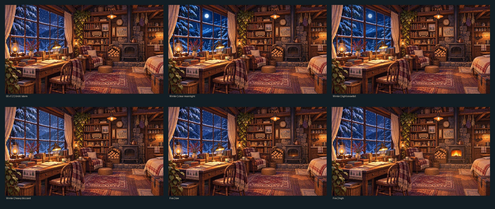

# 《风雪之外》05 v1.4｜正式木屋母图资产库（已上传真实图片）

> **高品质美术优先。** 此目录不使用 05 v1.1 偏灰、偏平淡的视觉基线，而以用户认可的 05 v0.9/v1.0 参考以及已确认的 **05 v1.2 熄火空屋母图**为标准。

## 这里已经真正存在哪些图片？

| 类型 | 文件 | 当前性质 |
|---|---|---|
| **原始母图** | [无损母图 PNG](master/cabin_unlit_approved.png) | **1672×941、原始 05 v1.2 像素完全一致**，SHA-256 `41213918be1e899f939436905f0d1447f37209368b092b7cc9b1d91819147af9`，已由 [Actions 43556619259](https://github.com/taoking/beyond-the-storm/actions/runs/43556619259) 核对 |
| 浏览版 | [母图 WebP](master/cabin_unlit_approved.webp) | 1672×941、Q94 高品质浏览版，**不是无损原件** |
| 炉火预览 | [余烬](previews/fire_ember.webp) · [小火](previews/fire_low.webp) · [中火](previews/fire_mid.webp) · [旺火](previews/fire_high.webp) | 统一 v1.2 室内构图、暖光变化；余烬和中火从原有透明火态局部衍生，待目视验收 |
| 冬季天气预览 | [晴朗月夜](previews/winter_clear_moonlit.webp) · [小雪](previews/winter_light_snow.webp) · [暴雪增强](previews/winter_blizzard.webp) | 保持家具窗框固定的冬夜视觉样张；普通风雪用母图，增加至四种冬季天气预览 |
| 炉火与光照 PNG 层 | `layers/fire_ember/low/mid/high.png`、`layers/glow_ember/low/mid/high.png` | 有真实透明通道，与 v1.2 母图同坐标 |
| 天气 PNG 层 | `layers/weather_blizzard_additive.png`、`weather_clear_approx_override.png`、`weather_light_snow_approx_override.png` | 增量暴雪 + 冷色窗景近似覆写，**仍非完整可替换的独立窗外景深** |
| 从同一母图裁切 | [雪窗](cameras/window_unlit.webp) · [炉边](cameras/hearth_unlit.webp) | 同一间木屋取景，不是为不同镜头重新生成家具 |

**资产目录确实包含 23 张图片**，另有 `manifest.json` 逐文件记录文件大小、Git Blob SHA、已完成和未完成内容。仓库路径 `assets/05/v1.4/` 已在 GitHub 中实地验证。用于恢复无损 PNG 的 6 个分块在 `.parts/`，属于传输中间数据，不是美术图层，也不应被游戏加载。

## 本轮保持的目标品质

- 窗外是蓝色的雪林与夜色，屋内是金橙桌灯、煤油灯与木材，**强烈且舒服的冷暖对比**；
- 大雪窗和窗下书桌仍是第一视觉中心，保留书籍、纸张、茶杯、植物、旧仪器等真实生活感；
- 炉边扶手椅、毛毯、柴堆、床和料理区都是同一可信空间；
- 正式图不包含人物、额外宠物、游戏 HUD、中文说明、格子展示板；
- 熄火时无火苗／余烬；不同火态只改变炉膛和合理的暖光；
- WINDOW / HEARTH 镜头只裁同一母图，**人物不在取景里时允许自然空镜，不为画面好看就改变世界事实**。

## “完成全部高质量母图”的后续清单

设计 05 中的“全套”不是把 5 种炉火 × 4 种天气硬画成 20 间屋子，而是**统一高品质母图＋真实可拆的可变景物**：

1. **P0｜独立窗外母景**：真正分别绘制晴夜、小雪、风雪、暴雪的远山／雪松／天空底图，与窗框/玻璃/雪粒遮挡分离。当前的晴夜、小雪只是室内完全锁定的高品质视觉预览，原始风雪仍有烘焙痕迹。
2. **P0｜季节与时段**：春、夏、秋、冬四季窗外母景，以及清晨、日间、黄昏、夜晚的自然光；尽量以可复用的外景与光照模块组合，不为每个条件挪动书桌。
3. **P1｜真实条件物件**：五档炉火动画与火光、修缮前后的床褥／窗帘／暖棚／设施、木柴与食物可见量、六处展示位／球果罐。
4. **P1｜角色图层**：九种真实表现姿态、室内外服装、道具和遮挡关系，风格必须匹配正式母图。
5. **P2｜户外母场景**：院子/屋旁安全圈、松林、溪谷、冰湖各自高品质母景，以 03 区域结构为准；这些是**不同地点**，不是同一室内母图的天气组合。
6. **验收**：在 320×180、480×270、小窗与全景的 Mac 实际显示大小评估美术，而不是用 CI、WebP 或分层命名代替视觉判断。

其他 05 早期 v0.6 低保真 SVG 及 v1.1 分层草图都只能用于技术参考，不能用其画风替换本目录母图。

**注意**：GitHub 这批真实图片已经上传、可直接打开，但本目录不宣称“所有母图已全部完成”或“完整可编辑原画图层已交付”。精确的完成状态见 [manifest.json](manifest.json) 与仓库 `设计/05_美术与音频.md` 的 v1.4 章节。
